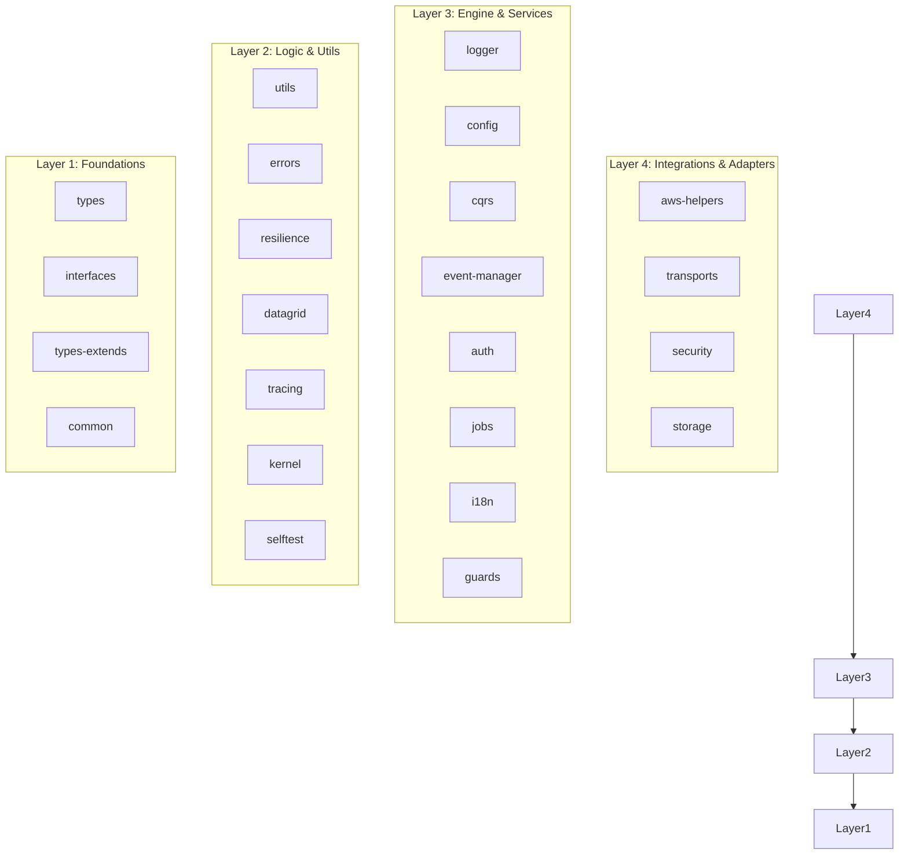

# `@node-yalc` — Framework-Agnostic Node.js Core Utilities

> **Node-YALC**: Pure TypeScript & Node.js shared core library collection. Designed to be completely framework-agnostic, zero-overhead, and shared across standalone microservices, Ferrox-Node applications, and NestJS services.

[](https://opensource.org/licenses/AGPL-3.0)
[](https://www.typescriptlang.org/)

---

## 1. 🧠 Philosophy & Purpose

The core principle of `@node-yalc` is absolute abstraction from any web framework (Fastify, Express, NestJS). It was engineered to house all business logic, security controls (Sentinel, PASETO), cloud service integrations (AWS SDK), and domain error handling in modular, framework-agnostic packages. The goal is to facilitate seamless domain code reuse across `ferrox-node` and `nestjs-yalc` without friction or cross-dependency contamination.

## 2. 🧅 Architectural Layering

`@node-yalc` structures its internal packages across strict non-overlapping layers to completely prevent dependency cycles:



## 3. ⚙️ How it Works

The infrastructure is built as an **NPM Workspace Monorepo**. Each submodule resides in its own directory with its own TypeScript source code (`src/`) and type declarations. Centralized build scripts (e.g., `build.mjs`) orchestrate `tsc` compilation and distribute `.js` and `.d.ts` artifacts into each submodule's `dist/` folder. In production or local development, the monorepo can be published to an npm registry, synchronized via a local Yalc store (`npx yalc publish`), or consumed directly as a Git submodule.

## 4. 📐 Design Rationale

This modular approach ensures:
- **Zero Overhead**: You only import and bundle what your service requires.
- **Universal Portability**: Code is not tied to framework-specific constructs (e.g., NestJS decorators or Express Request/Response objects).
- **Security Isolation**: Critical modules like `security` (AI Sentinel integration) or `kernel` (Linux Landlock and AppArmor primitives) can be audited and patched independently of application logic.
- **Determinism**: By anchoring dependencies via semantic versioning or pinned submodule commits, downstream projects avoid breaking changes from unpinned floating dependencies.

## 5. 📖 Package Catalog & API Reference

Below is the complete reference of packages maintained within the workspace:

1. **`auth`**: Authentication services implementing PASETO v4 local/public tokens and TOTP Multi-Factor Authentication (MFA).
2. **`aws-helpers`**: Modern wrappers for AWS SDK v3 covering S3, Lambda, SSM Parameter Store, and KMS.
3. **`common`**: Global domain constants, shared base DTOs, and serialization utilities.
4. **`config`**: Advanced environment variable validation and schema parsing (`ConfigEngine`).
5. **`cqrs`**: Enterprise Command/Query Responsibility Segregation and distributed Saga orchestration (`CqrsSagaEngine`).
6. **`datagrid`**: Query builder utilities for server-side pagination, sorting, filtering, and CRUD operations.
7. **`errors`**: Domain exception hierarchy (`AppError`, `DomainError`, `NotFoundError`, `ConflictError`).
8. **`event-manager`**: Type-safe in-memory pub/sub event bus (`YalcEventBus`).
9. **`guards`**: Role-Based Access Control (RBAC) evaluators and mandatory HTTP compliance headers.
10. **`i18n`**: Zero-dependency internationalization engine with parameterized translation interpolation.
11. **`interfaces`**: Abstract contracts and interfaces (e.g., `ILogger`, `IFerroxHttpAdapter`).
12. **`jobs`**: Background job queue manager and task scheduler.
13. **`kernel`**: Low-level interfaces for Linux security sandbox primitives (Landlock, seccomp).
14. **`logger`**: Ultra-high-performance structured logger powered by Pino, featuring automatic PII redaction.
15. **`resilience`**: Fault tolerance patterns including Circuit Breaker and configurable exponential backoff retry policies.
16. **`security`**: AI Sentinel integration providing threat defense (Prompt Injection mitigation, RAG poisoning detection).
17. **`selftest`**: Startup diagnostic engine validating database connectivity, environment invariants, and system health.
18. **`storage`**: Unified abstraction for local filesystem access and remote S3-compatible object storage.
19. **`tracing`**: Distributed telemetry instrumentation integrating OpenTelemetry W3C trace context propagation.
20. **`transports`**: HTTP and WebSocket transport adapters (`ExpressHttpAdapter`, `FastifyHttpAdapter`).
21. **`types`**: Fundamental TypeScript utility types and primitives (`Nullable`, `DeepPartial`, `ValueOf`).
22. **`types-extends`**: Advanced runtime type reflection and comprehensive type guard utilities.
23. **`utils`**: Pure functions for deep object cloning, high-concurrency mapping (`p-map`), string formatting, and date math.

**Usage Example (Logging & Structured Errors):**
```typescript
import { createYalcLogger } from '@node-yalc/logger';
import { NotFoundError } from '@node-yalc/errors';

const logger = createYalcLogger({ level: 'debug', redact: ['password', 'authorization'] });
logger.info("Service initialized successfully");

throw new NotFoundError("User not found", { userId: 123 });
```

## 6. ⚠️ Architectural Anti-Patterns

- ❌ **Framework Coupling**: Never import `@nestjs/common` or `express` inside `@node-yalc/utils` or `@node-yalc/domain`.
- ❌ **Circular Dependencies**: Prevent lower layers (e.g., `Layer 1: types`) from importing higher layers (e.g., `Layer 3: logger`). Strictly respect the layered topology.
- ❌ **Raw `console.log`**: Avoid unformatted `console.log`. Always utilize `ILogger` or `@node-yalc/logger` to ensure sensitive values (PII, tokens, secrets) are redacted.

## 7. 💡 Best Practices

- **Modular Testing**: Ensure utilities added to `utils` are accompanied by pure unit tests that do not require external databases.
- **Sensitive Data Redaction**: Always configure the logger with application-wide redaction keys (e.g., `['authorization', 'credit_card', 'secret']`).
- **Submodule Synchronization**: When pulling changes in consuming repositories, run `git submodule update --init --recursive` to ensure submodules match their expected target commits.
- **Local Yalc Workflow**: Leverage `npx yalc push` during local multi-repo development to test changes in downstream services prior to publishing.
