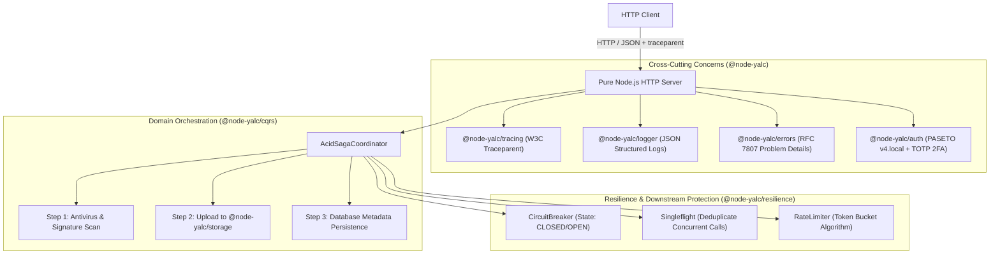

# 📦 @node-yalc Pure Standalone Microservice (Zero NestJS)

[](https://typescriptlang.org)
[](#architecture)
[](#security)
[](#tracing)

The **`@node-yalc` Standalone Microservice** is the architectural reference implementation demonstrating how to build a high-performance, enterprise-grade TypeScript microservice **without any framework lock-in** (such as NestJS or Express).

It leverages exclusively the modular, framework-agnostic `@node-yalc/*` libraries.

---

## 🏛️ Architecture & Clean Domain Separation



### Module Responsibilities
| Package | Component | Enterprise Purpose |
|---|---|---|
| **`@node-yalc/auth`** | `PasetoAuthService`, `TotpAuthService` | Tamper-proof authenticated symmetric encryption (`v4.local`) and RFC 6238 2FA |
| **`@node-yalc/cqrs`** | `AcidSagaCoordinator` | Distributed transactions with guaranteed reverse compensation upon failure |
| **`@node-yalc/storage`** | `StorageEngine`, `MemoryStorageAdapter` | Cloud-agnostic object storage with presigned URLs |
| **`@node-yalc/resilience`** | `CircuitBreaker`, `Singleflight`, `RateLimiter` | Cascading failure isolation, query deduplication, and traffic throttling |
| **`@node-yalc/tracing`** | `TracingEngine` | W3C `traceparent` distributed context propagation across boundaries |
| **`@node-yalc/logger`** | `AppLoggerFactory` | Enterprise structured logger with contextual metadata |
| **`@node-yalc/errors`** | `BadRequestError`, `UnauthorizedError`, etc. | Typed domain exceptions serializing into RFC 7807 problem details |

---

## 🚀 Quickstart & Docker

### Option 1: Docker Compose
```bash
cd examples/standalone-microservice
docker-compose up --build -d
```
The microservice starts on port `4000`.

### Option 2: Local Run with pnpm
```bash
pnpm --filter @node-yalc/standalone-microservice start
```

---

## 📡 API Reference & `curl` Examples

### 1. Healthcheck Probes
```bash
# Liveness Probe
curl -i -X GET http://localhost:4000/health/live

# Readiness Probe
curl -i -X GET http://localhost:4000/health/ready
```

### 2. PASETO v4 Authentication
```bash
# Obtain PASETO v4.local token
curl -i -X POST http://localhost:4000/api/v1/auth/login \
  -H "Content-Type: application/json" \
  -d '{"username": "senior_dev", "password": "yalc_master_secret"}'

# Setup TOTP 2FA
curl -i -X POST http://localhost:4000/api/v1/auth/totp/setup \
  -H "Content-Type: application/json" \
  -d '{"username": "senior_dev"}'
```

### 3. Distributed Saga Document Upload
```bash
# Token acquired from step 2
TOKEN="v4.local...."

curl -i -X POST http://localhost:4000/api/v1/documents \
  -H "Authorization: Bearer $TOKEN" \
  -H "Content-Type: application/json" \
  -H "traceparent: 00-4bf92f3577b34da6a3ce929d0e0e4736-00f067aa0ba902b7-01" \
  -d '{
    "filename": "quarterly_financials.pdf",
    "mimeType": "application/pdf",
    "content": "JVBERi0xLjQKJcTl8uXr..."
  }'
```

### 4. Saga Compensation on Malicious File
```bash
# Triggers Antivirus Step failure; automatically rolls back storage artifacts:
curl -i -X POST http://localhost:4000/api/v1/documents \
  -H "Authorization: Bearer $TOKEN" \
  -H "Content-Type: application/json" \
  -d '{
    "filename": "malware.exe",
    "content": "EICAR-TEST-SIGNATURE",
    "simulateScanFailure": true
  }'
```

---

## 🧪 Automated Testing

Execute the test suite verifying `@node-yalc` modules in complete isolation:

```bash
pnpm --filter @node-yalc/standalone-microservice test
```
